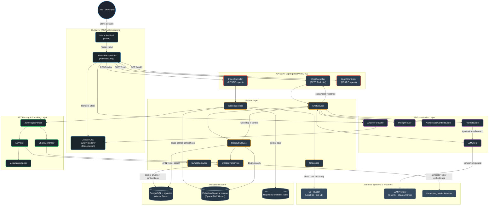

<p align="center">
  
</p>

<h1 align="center">ASTra</h1>

<p align="center">
  <strong>Stop reading code like text. Query it like a compiler.</strong><br>
  AST-Level Semantic Intelligence & Surgical Retrieval for Java Codebases
</p>

<p align="center">
  <a href="https://github.com/shravan606756/ASTra/actions/workflows/ci.yml"></a>
  <a href="LICENSE"></a>
  <a href="https://github.com/shravan606756/ASTra/releases"></a>
  <a href="https://github.com/shravan606756/ASTra/pulls"></a>
  <a href="https://github.com/shravan606756/ASTra/issues"></a>
</p>

<p align="center">
  <strong>Zero guesswork. Zero blind token splits. Complete architectural dominion.</strong>
</p>

Standard AI code search is fundamentally broken. Blindly slicing source files into arbitrary token chunks butchers method boundaries, severs inheritance chains, and feeds LLMs hallucinated noise.

**ASTra doesn't guess. It dissects.**

By compiling the Abstract Syntax Tree of every compilation unit, ASTra maps your entire Java repository into an interconnected, type-aware semantic graph. Ask anything in plain English—trace end-to-end execution flows, uncover hidden cross-package dependencies, or isolate exact implementations across hundreds of thousands of lines of code.

No hallucinations. No superficial keyword matching. Just surgical, line-accurate truth in milliseconds.

---

## Demo

> **ASTra in action** — from indexing a real Java codebase to answering questions with source-grounded results.

<p align="center">
  <a href="https://drive.google.com/file/d/1vfSgg-PW9mg9aFuq93alI2otVJ11tzm1/view?usp=sharing">
    
  </a>
</p>

---

## Core Capabilities

- **Structural AST Parsing** — Walks the abstract syntax tree of each compilation unit to extract packages, classes, interfaces, enums, records, and methods, resolving symbols via a type-aware symbol table so hierarchy and cross-references are preserved.
- **Semantic Chunking** — Splits code along logical language boundaries (class/method level) so retrieved context remains syntactically valid and coherent.
- **Hybrid Retrieval** — Combines dense semantic vector search via PostgreSQL (`pgvector`) with token-level lexical search via embedded Apache Lucene BM25, fused via Reciprocal Rank Fusion (RRF).
- **Adaptive Parallel Indexing** — Multithreaded pipeline with adaptive batching and dynamic memory management to index repositories rapidly without JVM heap exhaustion.
- **Context-Budgeted Natural Language Q&A** — Retrieves top-K code context under a strict token budget and routes queries through flexible LLM providers (OpenAI, Ollama, Groq).
- **Interactive Terminal Companion** — A fast, terminal-native CLI REPL with interactive commands, colored syntax, and session management.
- **One-Command Indexing** — Point directly at a local repository folder or clone and index straight from a Git URL.

---

## Architecture



| Workflow | Trigger | What Happens |
|---|---|---|
| **Indexing** | `POST /api/v1/index` | Clones or reads the target repository, parses the AST of every Java source file, chunks at logical boundaries, indexes lexical terms in Lucene BM25, generates vector embeddings, and persists everything with full repository statistics. |
| **Query** | `POST /api/v1/chat` | Classifies query intent, runs hybrid retrieval (dense vector search + sparse BM25) with reciprocal rank fusion, builds a context-budgeted prompt, and returns an LLM-grounded answer with source references. |
| **CLI Interaction** | `.\astra.bat` | Provides a live interactive REPL connected to the REST service, supporting natural language questions, code navigation commands, and real-time ANSI terminal rendering. |

---

## Query Modes

ASTra exposes purpose-built commands tailored for software engineering workflows:

| Command | What It Does |
|---|---|
| `ask` | Ask any natural-language question about the active repository |
| `class` | Explain a specific class — responsibilities, fields, and methods |
| `method` | Explain a specific method — logic, parameters, and return behavior |
| `architecture` | Explain the architecture of the repository or drill into a specific component |
| `workflow` | Trace and explain an execution workflow or process end-to-end |
| `dependencies` | List dependencies or find everything that uses a given class/method |
| `calls` | Find callers and invocation hierarchies for a specific method or class |
| `search` | Locate a specific code element across the entire repository |
| `summary` | Get a high-level summary of the entire indexed project |
| `design` | Surface design patterns and architectural principles in use |

---

## API Surface

ASTra runs as a Spring Boot REST service:

| Method | Endpoint | Description |
|---|---|---|
| `POST` | `/api/v1/index` | Unified indexing — routes local directory or Git URL automatically |
| `POST` | `/api/v1/index/local` | Index a project from a local filesystem path |
| `POST` | `/api/v1/index/git` | Clone and index a project directly from a Git URL |
| `POST` | `/api/v1/chat` | Ask a question and get a grounded, source-referenced answer |
| `GET` | `/api/v1/repositories` | List all currently indexed repositories |
| `GET` | `/api/v1/repositories/{id}/stats` | Get chunk and class counts for a specific repository |
| `DELETE` | `/api/v1/repositories/{id}` | Remove an indexed repository and its vector data |
| `GET` | `/api/v1/health` | Health check for the running ASTra instance |

### Quick Indexing Examples

```bash
# Index from a local directory
curl -X POST http://localhost:8080/api/v1/index \
  -H "Content-Type: application/json" \
  -d '{ "projectPath": "C:/projects/my-java-app", "repositoryId": "my-java-app" }'

# Index directly from GitHub
curl -X POST http://localhost:8080/api/v1/index \
  -H "Content-Type: application/json" \
  -d '{ "gitUrl": "https://github.com/javaparser/javaparser", "repositoryId": "javaparser" }'
```

---

## Tech Stack

| Layer | Technology |
|---|---|
| Language / Runtime | Java 21 |
| Application Framework | Spring Boot (WebMVC), Spring AI |
| CLI Environment | Windows Terminal / Console (Native `astra.bat` REPL) |
| AST Code Parsing | JavaParser (AST-level compilation units) |
| Vector Database | PostgreSQL with `pgvector` extension |
| Lexical Search | Embedded Apache Lucene 10 (BM25) |
| LLM & Embeddings | OpenAI, Groq, Ollama (`nomic-embed-text`) |

---

## Getting Started

### Prerequisites
- **Java 21** SDK
- **Docker & Docker Compose** (for PostgreSQL + `pgvector`)
- **Ollama** installed locally (for local text embeddings)
- **Groq API Key** (or OpenAI key for LLM chat completion)

### 1. Start the Database
Start PostgreSQL with `pgvector` using the provided Compose configuration:

```bash
docker compose up -d
```
*Maps to port `5432` and configures database `jcode_db` with default credentials.*

### 2. Set Up Local Embeddings
Pull the embedding model using Ollama:

```bash
ollama pull nomic-embed-text
```

### 3. Configure API Keys
Set your LLM API key in `application.properties` (or export as an environment variable):

```properties
spring.ai.openai.api-key=your_groq_api_key_here
```

### 4. Build and Run
Build the project and start the application:

```bash
.\mvnw.cmd clean install
.\mvnw.cmd spring-boot:run
```

### 5. Launch the CLI Companion
In a new terminal window, start the ASTra interactive shell:

```bash
.\astra.bat
```

